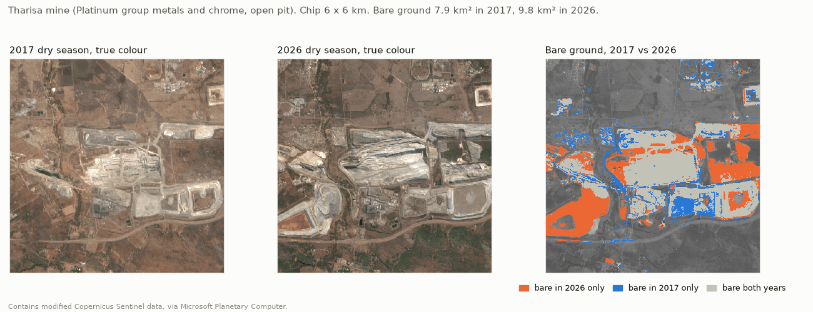
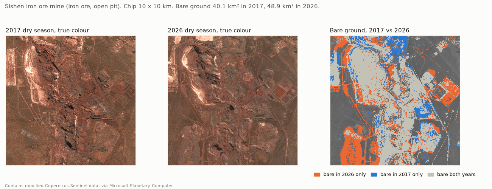
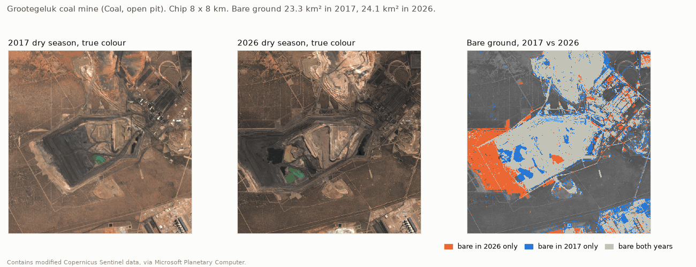
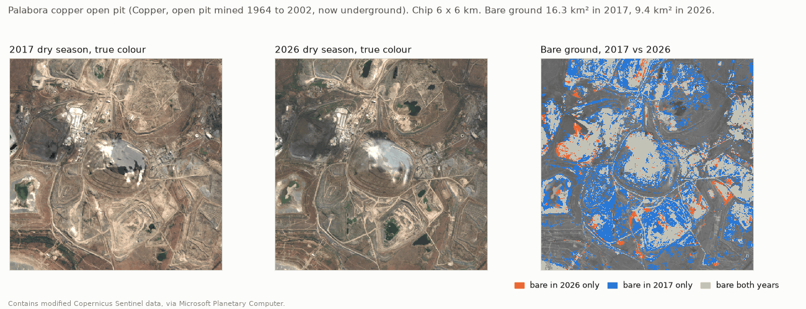
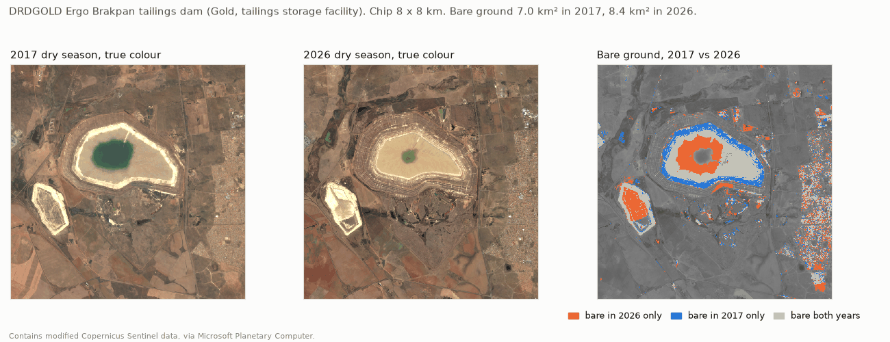
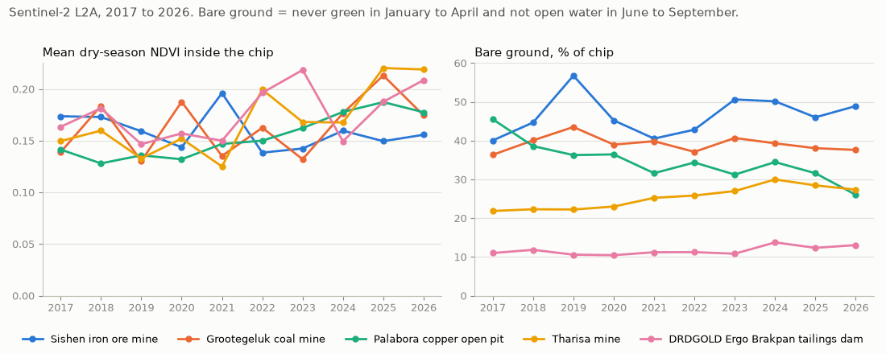
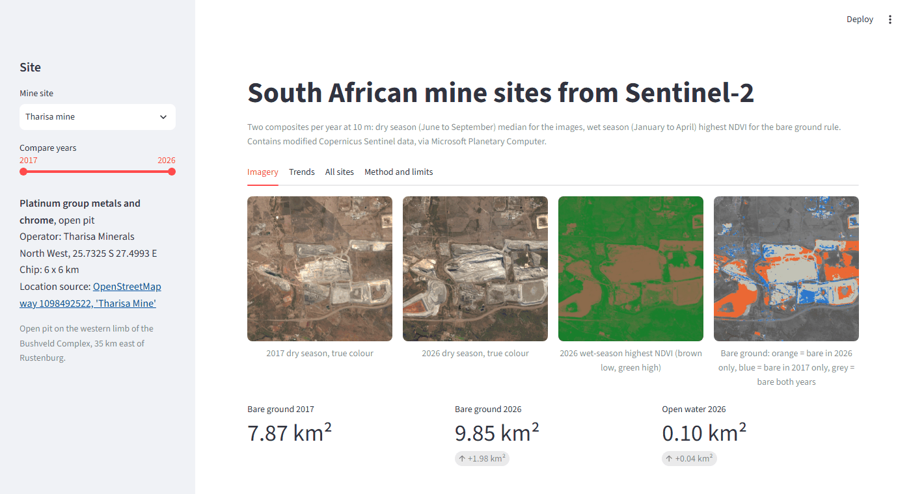

# South African mine sites from Sentinel-2

This project measures how the ground changes at five South African mine sites using free Sentinel-2 satellite images. For each site and each year from 2017 to 2026 it builds two cloud-masked composites, one from the dry winter and one from the green summer, computes vegetation, water and bare soil indices, and tracks how much of a small area around the mine is bare ground. It suits analysts who want a cheap, repeatable first look at mine footprint change, and a Streamlit app lets you compare any two years.



## Results, 2017 to 2026

All numbers come from `data/processed/site_metrics.csv` and `site_change.csv`, produced by `python run_pipeline.py` on 23 October 2026. "Bare ground" is the rule described under How it works, measured inside a square chip around each site; it is not the mine's official footprint.

| Site | Mineral, type | Chip | Bare 2017 (km²) | Bare 2026 (km²) | Change | Turned bare | Stopped being bare | Lowest and highest year |
|---|---|---|---|---|---|---|---|---|
| [Sishen](https://en.wikipedia.org/wiki/Sishen_mine), Northern Cape | Iron ore, open pit | 10 x 10 km | 40.1 | 48.9 | +8.9 | 15.4 | 6.6 | 40.1 (2017), 56.8 (2019) |
| [Grootegeluk](https://en.wikipedia.org/wiki/Grootegeluk_Coal_Mine), Limpopo | Coal, open pit | 8 x 8 km | 23.3 | 24.1 | +0.8 | 5.6 | 4.8 | 23.3 (2017), 27.8 (2019) |
| [Palabora](https://www.openstreetmap.org/way/47692302), Limpopo | Copper, open pit mined 1964 to 2002, now underground | 6 x 6 km | 16.3 | 9.4 | -6.9 | 1.0 | 8.0 | 9.4 (2026), 16.3 (2017) |
| [Tharisa](https://www.openstreetmap.org/way/1098492522), North West | Platinum group metals and chrome, open pit | 6 x 6 km | 7.9 | 9.8 | +2.0 | 4.1 | 2.1 | 7.9 (2017), 10.8 (2024) |
| [Ergo Brakpan tailings dam](https://www.openstreetmap.org/way/26354794), Gauteng | Gold, tailings storage facility | 8 x 8 km | 7.0 | 8.4 | +1.3 | 3.4 | 2.1 | 6.7 (2020), 8.8 (2024) |

What the images show:

- **Tharisa** (image above) gives the cleanest signal. Bare ground rose in every year but one from 7.9 km² in 2017 to 10.8 km² in 2024, while mean summer NDVI in the chip stayed between 0.41 and 0.49. Steady growth with flat NDVI suggests mining rather than rain. The new bare ground lies south-west and east of the pits.
- **Grootegeluk.** The pit grew west and south-west, and 5.6 km² of the chip turned bare in all. But open water in the pit grew from 0.14 km² to 0.83 km², and water does not count as bare, so the net change is small.
- **Sishen.** Bare ground grew by 8.9 km², much of it on the west and south-west of the chip. Read this one with care: it swings most from year to year. In 2019 the summer was the least green of the ten (mean peak NDVI 0.18 against 0.23 to 0.31 in other years) and 56.8 km² counted as bare, most likely because sparse Kalahari veld stayed under the NDVI cut.
- **Palabora.** Bare ground fell from 16.3 to 9.4 km², mostly on the waste rock dumps around the pit, which were greener in the 2026 summer (mean peak NDVI 0.26 in 2017, 0.41 in 2026). That could be plants taking hold on the dumps or a wetter summer; these data cannot tell which. The pit itself is bare in both years.
- **Ergo.** Witwatersrand gold is mined underground, so there is no pit to watch. This site is the Brakpan tailings dam of DRDGOLD's Ergo operation; DRDGOLD recovers gold by retreating old surface tailings and deposits the residue here. Open water on the dam shrank from 1.64 km² in 2017 to 0.40 km² in 2026, most of it between 2023 and 2024 (1.07 to 0.47 km²). Bare ground rose by 1.3 km², much of it where the pool used to be.

<details>
<summary>Site images, 2017 against 2026</summary>






</details>



Dry-season NDVI (left) moves from year to year at every site, mine or not, so treat it as context. The right chart is the bare ground share of each chip; the table above has the same numbers in km².

## How it works

1. **Sites** (`data/sa_mine_sites.geojson`). Five points, one per mineral, each checked against Wikipedia or OpenStreetMap (links in the file and in the table above). Each site gets a square chip, 6 to 10 km wide, on a 10 m grid in its UTM zone.
2. **Composites** (`scripts/download_and_process.py`). For each site, year and season the script searches the Microsoft Planetary Computer STAC API for Sentinel-2 L2A scenes. It reads only the chip from each scene, ranks scenes by clear sky inside the chip using the Scene Classification Layer (SCL), keeps the best five (at most one per day) and masks cloud, cloud shadow, cirrus and snow. Then:
   - **dry season, 1 June to 30 September**: per-pixel median of bands B02, B03, B04, B08 and B11. All five sites are in South Africa's summer rainfall region, so winter scenes are mostly clear and the veld is brown. This is the image you see.
   - **wet season, 1 January to 30 April**: per-pixel highest NDVI. Grass and bush turn green in summer; mine pits, dumps and tailings do not.

   Scenes made with processing baseline 04.00 or later (from January 2022) add 1000 to every digital number; the script removes this offset, so all years share one reflectance scale. Every scene used is listed in `data/processed/scenes.csv`.
3. **Indices** (`scripts/indices.py`, `scripts/features.py`).
   - NDVI = (B08 - B04) / (B08 + B04), vegetation
   - MNDWI = (B03 - B11) / (B03 + B11), open water
   - BSI = ((B11 + B04) - (B08 + B02)) / ((B11 + B04) + (B08 + B02)), bare soil
   - **Bare ground** = highest wet-season NDVI below 0.20 (it never turned green) and dry-season MNDWI below 0.30 (it is not open water). I picked both thresholds by looking at the composites; they are not calibrated against field data.

   How I got there: a dry-season-only rule (NDVI below 0.15, BSI above 0.10) counted brown winter veld as bare in dry years. Its year-to-year standard deviation of bare area was 3.6 to 5.6 km² per site; with the final rule it is 0.7 to 1.9 km² at four sites (Sishen stays at 5.1 km²). Both are in `site_metrics.csv` (`bare_km2_dry_rule`, `bare_km2`). The BSI cut also dropped grey rock in the Palabora and Tharisa pits (35 to 66% of never-green ground there has BSI of 0.10 or less) and kept some open water (a third of the water at Grootegeluk in 2026 has BSI above 0.10). The summer NDVI check cut the first problem at four of the five sites, and MNDWI replaced BSI as the water test; BSI is still reported but not used in the rule. The usual water cut of MNDWI above 0 also caught bright pit rock, hence 0.30.

   Per site and year the script writes mean dry-season NDVI, mean wet-season peak NDVI, mean BSI, bare ground area and share, and open water area to `data/processed/site_metrics.csv`, and a first-year against last-year summary to `data/processed/site_change.csv`.
4. **Figures** (`scripts/make_figures.py`) draws the images in `docs/`. All true-colour images use one fixed stretch, so years compare fairly.
5. **App** (`app.py`) shows any two years side by side, the wet-season NDVI map, the bare ground change map, yearly charts and the list of scenes. Add `?site=Tharisa_Platinum` (or another `site_id`) to the URL to open a site directly.



## How to run

Needs Python 3.10 or later (tested on 3.12) and an internet connection. No account or API key.

```bash
python -m venv .venv
source .venv/bin/activate          # Windows: .venv\Scripts\activate
pip install -r requirements.txt

python run_pipeline.py             # all three steps; the first run took about an hour here
python run_pipeline.py --step 2    # or one step at a time (1, 2 or 3)
pytest -q                          # index maths tests
streamlit run app.py
```

Step 1 skips composites that already exist, so a second run is fast. `python scripts/download_and_process.py --years 2026 --force` rebuilds one year. The composites are not in git; they take about 240 MB in `data/imagery/`. The CSVs in `data/processed/` and the images in `docs/` are in git, so you can read the results and run `streamlit run app.py` for the Trends and All sites tabs without step 1.

## Data sources and licences

| Data | Source | Licence | Accessed |
|---|---|---|---|
| Sentinel-2 Level-2A surface reflectance, January to April and June to September, 2017 to 2026 | [Microsoft Planetary Computer](https://planetarycomputer.microsoft.com/dataset/sentinel-2-l2a) STAC API, collection `sentinel-2-l2a` | [Copernicus Sentinel data terms](https://sentinels.copernicus.eu/documents/247904/690755/Sentinel_Data_Legal_Notice) (free and open). Contains modified Copernicus Sentinel data 2017 to 2026. | 23 October 2026 |
| Site coordinates | [Wikipedia](https://en.wikipedia.org/) (Sishen, Grootegeluk) and [OpenStreetMap](https://www.openstreetmap.org/) (Palabora, Tharisa, Ergo) | CC BY-SA 4.0 and ODbL 1.0 | 23 October 2026 |
| Site facts (operator, mine type) | Wikipedia pages above and [DRDGold](https://en.wikipedia.org/wiki/DRDGold); [Mining Technology, Tharisa](https://www.mining-technology.com/projects/tharisa/); [Miningmx on Ergo's Brakpan facility](https://www.miningmx.com/news/gold/66518-drdgold-wont-rush-withok-as-tailings-project-slips-to-2029/) | Cited, not copied | 23 October 2026 |

## Limits

- **Bare ground is not a mine boundary.** The rule also counts roads, roofs, ploughed fields and sparse natural cover, and it drops mine ground that has grown grass. Compare a site with itself over time, not one site with another.
- **Rain still matters.** After a poor rainy season more veld stays below the summer NDVI cut and counts as bare. Mean NDVI inside the chip changes with rain as well as with mining, and these data cannot separate the two.
- **Cloud.** The SCL mask misses some thin cloud and sometimes flags bright tailings or pit floors as cloud. Where every chosen dry-season scene flags a pixel, the composite falls back to the unmasked median of the same scenes; the share of such pixels is in `site_metrics.csv` (`gap_filled_frac`).
- **Water.** Open water does not count as bare, so a pond on a tailings dam or in a pit that grows or shrinks changes the bare area without any mining. Shallow or muddy water can fall below the MNDWI cut and count as bare.
- **Processing versions.** Scenes before 2022 on Planetary Computer use processing baselines 02.12 and 03.00; later ones use 04.00 to 05.12. The offset is handled, but small differences in atmospheric correction remain.
- **No production or economic data.** The images show surface change only. They say nothing about tonnes mined or revenue.

## Next steps

- Calibrate the bare ground thresholds against hand-labelled points or a published land cover map.
- Add Sentinel-1 radar, which sees through cloud, for sites or years with few clear scenes.
- Use mine boundaries from the Department of Mineral Resources and Energy, where public, to separate mining from other bare ground.

## Author

Tiiso Letsapa, Letsapamyron07@gmail.com

MIT licence, see `LICENSE.txt`.
